# SpecGuard

> **Motor de Desarrollo Dirigido por Especificaciones (SDD) y Gobernador Transaccional para Agentes de Código.**

SpecGuard no es una simple *skill* o extensión pasiva: es un **entorno de gobierno y persistencia transaccional** que transforma a los asistentes de inteligencia artificial (Antigravity, Claude Code, OpenCode, Gemini, Cursor) en ingenieros de software rigurosos y predecibles.

El principal problema de los agentes autónomos de código es la amnesia y la deriva: pierden el contexto tras compactaciones de ventana, olvidan el alcance original, omiten pruebas y auto-aprueban planes incompletos. SpecGuard traslada la verdad del proyecto **de la ventana de contexto al disco**, administrando el ciclo de vida de desarrollo mediante una máquina de estados ACID protegida por locks POSIX y un grafo acíclico dirigido (DAG) de tres fases.

---

## 🏗️ Los Pilares de SpecGuard

```mermaid
graph TD
    subgraph "1. Contrato Universal e Ignición"
        AGENTS["AGENTS.md / CLAUDE.md<br/>Directiva única y primacía de reglas"]
        READ_FIRST["sg context (Read-First Ignition)<br/>Asimilación sin generación prematura de código"]
    end

    subgraph "2. FASE PLAN (Protocolo Raíz de 2 Archivos)"
        ROOT_DOCS["requirements.md (PRD) & design.md (SAD)<br/>Únicas fuentes de verdad visibles"]
        DOUBT["Doubt-Driven Intake (sg next-rf-id)<br/>Entrevista y desambiguación antes de codificar"]
        TOKEN_ANCHOR["Token Anchoring (sg glossary-check)<br/>Glosario estricto y sinónimos prohibidos"]
        SCOPE["Fuera del Alcance (Out of Scope)<br/>Bloqueante vía sg validate-spec"]
        CRIT["Criterios Secuenciales<br/>CRIT-&lt;rf&gt;-&lt;n&gt; [automated/manual]"]
        GATE{"Compuerta Humana<br/>gate.mode: chat | strict"}
    end

    subgraph "3. FASE EXECUTE (Cursor de Bajo Consumo)"
        SESSION[".spec-guard/SESSION.md (~250 tokens)<br/>Validación de ancestría Git: merge-base"]
        TDD["Ciclo TDD (RED -> GREEN -> REFACTOR)<br/>Tests atados a CRIT-&lt;rf&gt;-&lt;n&gt;"]
        CHECKPOINT["sg session-checkpoint<br/>Actualización atómica en disco"]
    end

    subgraph "4. FASE VERIFY (Puerta Determinista)"
        VERIFY_CRIT["sg verify-crit<br/>Auditoría 1:1 de CRIT contra tests"]
        GLOSSARY_AUDIT["sg glossary-check<br/>Auditoría de sinónimos prohibidos"]
        MARK_RF["sg mark-rf<br/>Cierre determinista de RF-XXX cubiertos"]
        CLEAN_GIT["Git Working Tree Limpio<br/>Commit previo obligatorio"]
        ARCHIVE["Auto-Archivado del Cambio<br/>Consolidación en archive/ y purga de SESSION.md"]
    end

    AGENTS --> READ_FIRST
    READ_FIRST --> ROOT_DOCS
    ROOT_DOCS --> DOUBT --> TOKEN_ANCHOR --> SCOPE --> CRIT
    CRIT --> GATE
    GATE -->|Aprobado| SESSION
    SESSION --> TDD --> CHECKPOINT
    CHECKPOINT --> VERIFY_CRIT
    VERIFY_CRIT --> GLOSSARY_AUDIT --> MARK_RF --> CLEAN_GIT --> ARCHIVE
```



### 1. Protocolo Raíz de 2 Archivos (Cero Fricción Documental)
Erradica la dispersión de especificaciones y el caos en la raíz del repositorio. Toda la definición funcional y técnica del proyecto se concentra en dos únicos archivos vivos:
- `requirements.md` (PRD): Visión, Glosario Estricto, Roles de Usuario, Requerimientos Funcionales (`### [ ] RF-XXX: ...`) con criterios de aceptación (`CRIT-<rf>-<n>`), y sección obligatoria **Fuera del Alcance** (*Out of Scope*).
- `design.md` (SAD): Stack tecnológico obligatorio, Modelo de Datos, Contratos de Interfaz/HTMX, Reglas de Arquitectura y Seguridad.

Toda la maquinaria transaccional, logs, bloqueos y metadatos residen ocultos en `.spec-guard/`.

### 2. Token Anchoring y Glosario Estricto (`sg glossary-check`)
Elimina la deriva semántica del agente impidiendo la invención o mezcla de términos del dominio. `requirements.md` define una tabla estricta de términos permitidos y sus sinónimos prohibidos. `sg glossary-check` audita los cambios en Git (en código, pruebas y comentarios) para asegurar que nunca se introduzca vocabulario prohibido.

### 3. Ignición Read-First y Doubt-Driven Spec Intake (`sg context`, `sg next-rf-id`)
El agente nunca asume requerimientos ambiguos ni escribe código prematuramente:
- **Read-First Ignition (`sg context`)**: Al iniciar cualquier sesión, el agente asimila de forma compacta el estado transaccional, las reglas globales, el stack y el glosario antes de proponer cambios.
- **Doubt-Driven Spec Intake**: Ante requerimientos nuevos o vagos, el agente adopta un rol de entrevistador, formula preguntas de clarificación, sugiere el siguiente identificador con `sg next-rf-id` y redacta la especificación formal antes de abrir el cambio con `sg init-change`.

### 4. Trazabilidad Determinista de Criterios (`CRIT-XX`) y Cierre de RFs (`sg mark-rf`)
Todo requerimiento funcional desglosa criterios `CRIT-<rf>-<n>` (`[automated]` o `[manual]`). El comando `sg verify-crit` audita con boundary exacto (`\b`) que cada criterio automatizable cuente con su test correspondiente (`test_crit_101_1_...`). Durante la fase `verify`, `sg mark-rf` es el único mecanismo autorizado para marcar el RF como completado (`[x]`) una vez verificados todos sus criterios.

### 5. Cursor de Sesión de Bajo Consumo (`.spec-guard/SESSION.md`)
Para evitar consumir miles de tokens releyendo especificaciones extensas en cada prompt durante la implementación, SpecGuard genera un cursor volátil `.spec-guard/SESSION.md` (~250 tokens), fuera de la raíz del proyecto. Incluye validación de ancestría Git (`git merge-base --is-ancestor`) para alertar al instante si el repositorio sufrió rebases o desincronizaciones tras una compactación de contexto.

### 6. Modos de Compuerta Humana Configurables (`chat` vs `strict`)
El agente **nunca puede auto-aprobarse** para comenzar a modificar código fuente:
- **Modo `chat` (Predeterminado — Cero Fricción)**:
  Diseñado para pair-programming interactivo. El agente está obligado a hacer un **STOP** explícito en la conversación, presentar el plan y solicitar tu autorización. Al responder afirmativamente en el chat, el agente ejecuta `sg commit` registrando la aprobación (`plan_approved_by = chat`) sin salir de la conversación.
- **Modo `strict` (Máxima Seguridad Adversarial)**:
  Diseñado para agentes autónomos con ejecución de consola desatendida. `sg commit` rechaza la fase con código `EXIT_GATE_REQUIRED (5)` y exige un token criptográfico generado fuera de banda en la terminal física interactiva del humano (`/dev/tty`) mediante `sg plan-approve` y `sg plan-confirm`.

### 7. Motor Transaccional ACID
Garantiza aislamiento estricto entre fases mediante `BEGIN`, `COMMIT`, `ROLLBACK` y `CHECKPOINT`. Utiliza bloqueos de archivo POSIX (`fcntl`), con caducidad TTL automática y detección de locks estériles (*stale lock recovery*).

---

## 📦 Interfaces del Sistema

SpecGuard se manifiesta según la necesidad de tu entorno:

1. **CLI Unificado (`sg` / `spec-guard`)**: Herramienta de línea de comandos en `$PATH` para humanos y agentes.
2. **Skill Nativa para Antigravity**: Registrada en `~/.gemini/config/skills/spec-guard/SKILL.md`.
3. **Sub-Agente y Slash Commands para OpenCode**: Registrado en `opencode.jsonc` con comandos dinámicos (`/init`, `/new`, `/continue`, `/status`, `/checkpoint`, etc.).
4. **Servidor MCP (`spec-guard-mcp`)**: Herramientas (`get_project_context`, `check_glossary`, `get_rf_status`, `begin_phase`, `commit_phase`, `rollback_phase`, `checkpoint`, `session_checkpoint`, `verify_criteria`, `validate_spec`) y recursos URI (`spec://requirements`, `spec://design`, `spec://session`, `spec://{change}/objective`, `spec://{change}/design`) sobre standard I/O para clientes MCP (Claude Desktop, Cursor, OpenCode).
5. **Daemon de Hooks en Background (`sg hooks-start`)**: Automatización de tareas derivadas (linting, sync de tests) con prohibición hardcodeada de tocar especificaciones.
6. **Script Local de Verificación (`.spec-guard/bin/verify-crit.sh`)**: Script ligero y portable para auditar criterios sin dependencias externas.

---

## 🚀 Instalación y Puesta en Marcha

### 1. Instalación Universal en el Sistema

Ejecuta el script de instalación desde la raíz del repositorio:

```bash
bash scripts/install.sh
```

El instalador:
- Compila e instala el paquete `spec_guard` en `~/.agents/skills/spec-guard/`.
- Crea los enlaces simbólicos ejecutables en `~/.local/bin/` (`sg`, `spec-guard`, `sg-verify-crit`, `sg-init`).
- Registra la skill nativa en Antigravity (`~/.gemini/config/skills/spec-guard/SKILL.md`).
- Configura el agente en OpenCode (`~/.config/opencode/opencode.jsonc`) y genera los slash commands.
- Inyecta el contrato de arranque en `~/.gemini/GEMINI.md`.

### 2. Inicializar SpecGuard en un Nuevo Repositorio

En cualquier repositorio que quieras gobernar con SpecGuard:

```bash
sg init
# o dentro de una sesión de chat con un agente:
/init
```

Esto detectará el stack de tu proyecto y creará:
- `requirements.md` (PRD base con glosario estricto de términos y sinónimos prohibidos, roles, RF de ejemplo y Out of Scope).
- `design.md` (SAD base con stack obligatorio precargado, modelo de datos, contratos y arquitectura).
- `AGENTS.md` (contrato universal de agentes) y enlace simbólico en `CLAUDE.md`.
- `.spec-guard/config.yaml` (configurado por defecto con `gate.mode: chat`).
- `.spec-guard/bin/verify-crit.sh` (script de verificación local).
- Directorios `.spec-guard/changes/` y `.spec-guard/specs/`.

---

## 🔄 Flujo de Trabajo Cotidiano

### Paso 1: Especificación y Apertura del Cambio (Fase PLAN)
1. **Ignición Read-First**: El agente asimila el contexto antes de actuar:
   ```bash
   sg context
   ```
2. **Doubt-Driven Spec Intake**: Si el requerimiento es nuevo o contiene ambigüedades, el agente adopta el rol de entrevistador (pregunta en chat antes de asumir), obtiene el siguiente identificador disponible con `sg next-rf-id` y redacta la especificación formal:
   - En `requirements.md`: agrega la sección `### [ ] RF-XXX: ...` con criterios de aceptación numerados `CRIT-<rf>-<n>` (`[automated]` o `[manual]`) y actualiza el *Out of Scope*.
   - En `design.md`: actualiza los modelos de datos, contratos de interfaz y reglas técnicas.
3. **Apertura de la Transacción**:
   ```bash
   sg init-change --change agregar-autenticacion --rf RF-101
   sg begin --change agregar-autenticacion --phase plan
   # o en chat:
   /new agregar-autenticacion
   ```
   *(En repositorios en modo legacy sin documentos en la raíz, el agente redactará `objective.md`, `design.md` y `tasks.md` dentro de `.spec-guard/changes/agregar-autenticacion/specs/`).*

### Paso 2: Validación y Compuerta Humana
El agente valida la especificación y audita la coherencia del glosario:
```bash
sg validate-spec --change agregar-autenticacion
sg glossary-check
```

- **En Modo `chat` (Default — Cero Fricción)**: El agente hace una pausa obligatoria (**STOP**), resume el plan en el chat y solicita confirmación. Tras tu visto bueno, ejecuta el commit a `execute`:
  ```bash
  sg commit --change agregar-autenticacion --next-phase execute
  ```

- **En Modo `strict`**: Si configuraste `gate.mode: strict`, `sg commit` requerirá token interactivo generado fuera de banda:
  ```bash
  # En tu terminal física:
  sg plan-approve --change agregar-autenticacion
  sg plan-confirm --change agregar-autenticacion --token <TOKEN>
  ```

### Paso 3: Implementación con Cursor Ligero (Fase EXECUTE)
El agente inicia la transacción de ejecución:
```bash
sg begin --change agregar-autenticacion --phase execute
# o en chat:
/continue
```
- Se genera `.spec-guard/SESSION.md` (~250 tokens), registrando el `base_commit` de Git y el cursor de trabajo.
- El agente aplica el ciclo **TDD**: escribe las pruebas nombradas según el criterio (`test_crit_101_1_login_exitoso`) antes de escribir la implementación.
- Cada avance actualiza el checkpoint atómicamente:
  ```bash
  sg session-checkpoint --change agregar-autenticacion --action "Completada lógica de autenticación"
  ```
- Al terminar la implementación, avanza a verificación:
  ```bash
  sg commit --change agregar-autenticacion --next-phase verify
  ```

### Paso 4: Verificación Determinista, Cierre de RF y Archivado (Fase VERIFY)
```bash
sg begin --change agregar-autenticacion --phase verify
# o en chat:
/continue
```
1. **Auditoría de Criterios**: Se corre `sg verify-crit --change agregar-autenticacion` (o `.spec-guard/bin/verify-crit.sh`). Si algún `CRIT-<rf>-<n> [automated]` no cuenta con tests en el código fuente, la fase se interrumpe con error.
2. **Auditoría de Glosario**: `sg glossary-check` audita que el diff no contenga sinónimos prohibidos definidos en `requirements.md`.
3. **Cierre de Requerimiento Funcional**: `sg mark-rf --change agregar-autenticacion --rf RF-101` valida la cobertura total de criterios y marca el checkbox `### [x] RF-101: ...` en `requirements.md`.
4. **Suite de Pruebas y Build**: Se ejecutan los comandos de test y build del proyecto.
5. **Commit de Git**: El árbol de trabajo debe confirmarse limpiamente en Git (`git commit`).
6. **Archivado Automático**: Se consolida el cambio en `.spec-guard/changes/archive/YYYY-MM-DD-agregar-autenticacion/`, se actualiza el histórico y se purga `.spec-guard/SESSION.md`.

---

## 🛠️ Referencia de Comandos CLI (`sg`)

| Subcomando | Descripción | Ámbito |
|---|---|---|
| `sg init` | Inicializa `requirements.md`, `design.md`, `AGENTS.md` y `.spec-guard/` en el proyecto | Humano / Agente |
| `sg context [--json]` | Compila e inyecta el contexto del proyecto (Read-First Ignition, reglas, glosario, stack) | Agente / Humano |
| `sg next-rf-id` | Calcula y sugiere el siguiente identificador secuencial disponible (`RF-XXX`) | Agente / Humano |
| `sg init-change --change <c> [--rf <id>]` | Crea el cambio y fija su scope de RF en `requirements.md` (o specs delta) | Agente |
| `sg rf-status [--change <c>]` | Muestra el estado de los RFs de `requirements.md` (totales, pendientes, completados) | Agente / Humano |
| `sg mark-rf --change <c> --rf <id>` | Marca un RF como completado (`[x]`) tras verificar cobertura total de criterios | Agente |
| `sg glossary-check [--staged] [--strict]` | Audita el diff contra la tabla de términos permitidos y sinónimos prohibidos | Agente / Humano |
| `sg begin --change <c> --phase <p>` | Inicia una transacción ACID para la fase (`plan`, `execute`, `verify`) | Agente |
| `sg commit --change <c> --next-phase <p>` | Confirma la fase actual y avanza el DAG transaccional | Agente |
| `sg rollback --change <c>` | Revierte la transacción activa a estado `idle` | Agente / Humano |
| `sg checkpoint --change <c> --summary <s>` | Guarda un resumen en `state.ini[Session]` (límite 2000 caracteres) | Agente |
| `sg session-checkpoint --change <c>` | Genera o actualiza el cursor volátil `.spec-guard/SESSION.md` validando ancestría Git | Agente |
| `sg status [--change <c>]` | Muestra el estado del grafo transaccional y el cambio activo | Humano / Agente |
| `sg list-changes` | Lista todos los cambios activos y archivados con su fase y fecha | Humano / Agente |
| `sg mark-task --change <c> --task <id>` | Marca una tarea individual como completada en `tasks.md` (modo legacy) | Agente |
| `sg next-task --change <c>` | Muestra la siguiente tarea pendiente de implementación (modo legacy) | Agente |
| `sg check-completion --change <c>` | Valida si todas las tareas del cambio han sido completadas | Agente |
| `sg validate-spec --change <c>` | Verifica integridad estructural y presencia obligatoria de *Out of Scope* | Agente / Humano |
| `sg verify-crit --change <c>` | Audita trazabilidad 1:1 de criterios `CRIT-XX` contra suites de test | Agente / Humano |
| `sg verify-gate --change <c>` | Verifica si el cambio cumple los requisitos para avanzar la compuerta humana | Agente |
| `sg plan-approve --change <c>` | Emite token de aprobación fuera de banda en `/dev/tty` (modo `strict`) | **Solo Humano** |
| `sg plan-confirm --change <c> --token <t>` | Valida el token y aprueba el plan (modo `strict`) | **Solo Humano** |
| `sg hotfix-init --change <c> --reason <r>` | Solicita bypass auditado de hotfix fuera de banda | **Solo Humano** |
| `sg hotfix-confirm --change <c> --token <t>` | Consume token y desbloquea inicio directo en `execute` | **Solo Humano** |
| `sg migrate` | Migra configuraciones o estados de versiones anteriores | Humano / Agente |
| `sg install-hooks` | Instala hooks de Git en el repositorio | Humano |
| `sg hooks-start` / `status` / `stop` | Administra el observador en background de reglas derivadas | Humano |

---

## ⚙️ Configuración (`.spec-guard/config.yaml`)

```yaml
schema: spec-driven

gate:
  mode: chat  # 'chat' (default, cero fricción) | 'strict' (fuera de banda /dev/tty)

glossary:
  severity: warning  # 'warning' (default en diffs de código) | 'critical'

rules:
  change_naming: kebab-case
  execute:
    - Seguir patrones y convenciones existentes del proyecto
    - Aplicar TDD asociando cada test a un criterio CRIT-<rf>-<n>
  verify:
    - build_command: pytest  # o npm test / make test
    - Criterios CRIT automatizables deben contar con tests unitarios
```

---

## 🧪 Pruebas Automatizadas

SpecGuard cuenta con una exhaustiva suite de pruebas unitarias y de estrés concurrente (POSIX locking, mitigación de condiciones de carrera, verificación criptográfica de tokens y validación de modos de compuerta):

```bash
python3 tests/run_tests.py
```

```text
Resultados: 97 PASSED, 0 FAILED
✓ Todas las suites de pruebas completadas con éxito.
```

---

## 📄 Licencia

Distribuido bajo la licencia [MIT](LICENSE).
